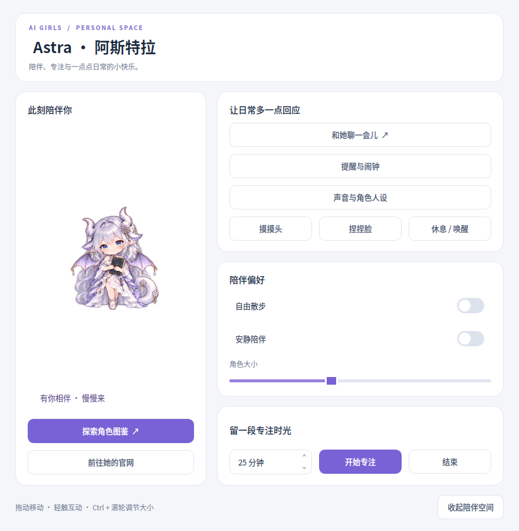
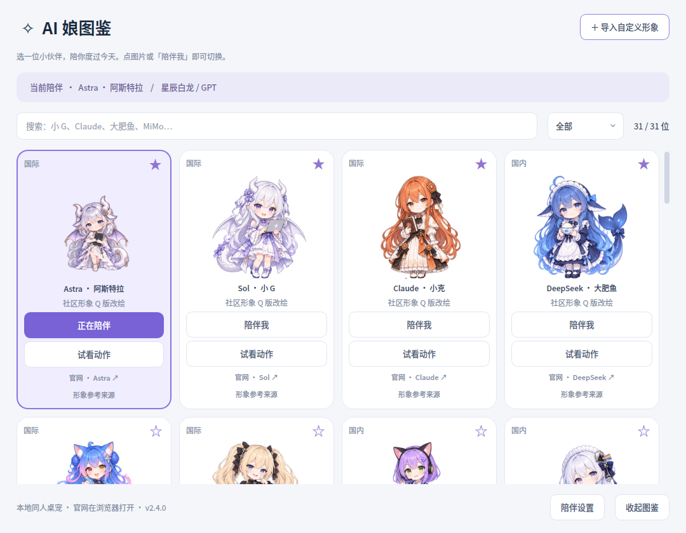
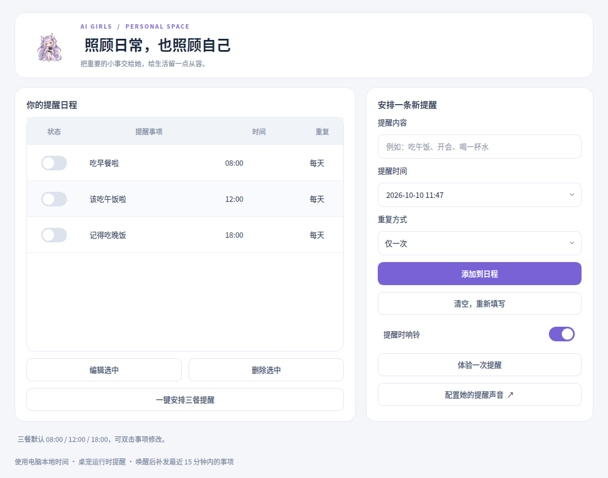
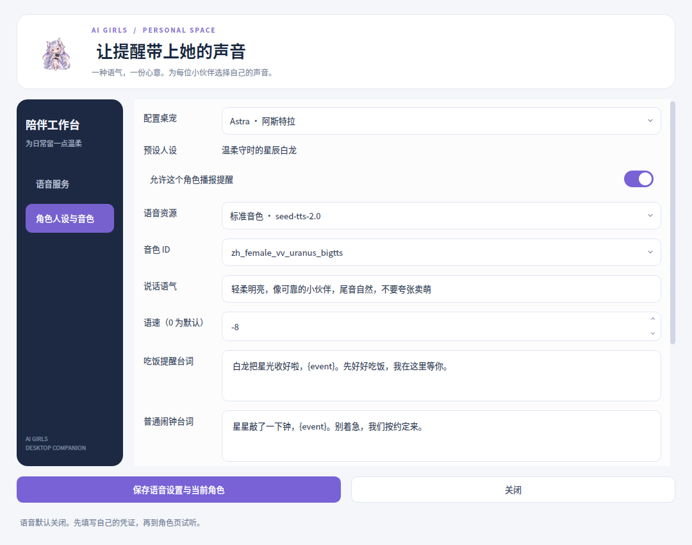

# AI 娘桌宠

把喜欢的 AI 娘请到桌面，陪你聊天、专注，也提醒你好好吃饭。

**31 位角色 · 摸头与捏脸 · 自由散步 · 吃饭提醒与闹钟 · 自带 API 聊天 · 角色语音**

## 下载与安装

目标平台为 **Windows 10 / 11，64 位**，安装版内置运行环境，无需安装 Python。

**当前版本：2.4.1**

[下载 Windows 安装包](https://github.com/l752266190/ai-girls-desktop-pet/releases/download/v2.4.1/AI娘桌宠-Setup-2.4.1-x64.exe) · [版本说明与校验文件](https://github.com/l752266190/ai-girls-desktop-pet/releases/tag/v2.4.1)

下载 `.exe` 后双击安装。安装包未做代码签名，Windows 可能显示未知发布者；请核对本仓库发布地址及 SHA256。

此版本编译应用代码，不附带项目 Python 源文件。安装后可从系统“应用”列表卸载；用户设置和自定义素材保留。

这是软件介绍与分发仓库，源码保持私有；允许下载使用不代表开放源码授权。

## 她能做什么

| 功能 | 说明 |
| --- | --- |
| 角色图鉴 | Astra、Sol 小 G、Claude、DeepSeek、GLM、千问、豆包、Kimi 等 31 位角色；支持搜索、收藏和导入自定义透明图片 |
| 触碰互动 | 点头顶摸头，点脸颊捏脸；角色拥有待机、眨眼、触碰、睡眠和迈步动作 |
| 自由散步 | 在屏幕可用区域内随机上下左右与斜向移动，碰边转向 |
| 日常提醒 | 三餐、一次性、每日和工作日闹钟；支持稍后提醒 |
| 专注计时 | 1–180 分钟，专注期间暂停主动散步与台词 |
| 模型聊天 | 使用自己的 API 配置连接模型，角色分别绑定连接和保存本次运行的对话 |
| 角色声音 | 使用自己的豆包语音凭证，为各角色选择音色、语速与提醒台词 |
| 官网入口 | 在系统浏览器打开对应产品官网，自行登录使用 |

## 常用操作

- **拖动角色**：移动位置；**双击**：打开陪伴空间；**右键**：功能菜单。
- **点头顶 / 点脸颊**：摸头 / 捏脸；**Ctrl + 滚轮**：调整大小。
- 在“陪伴偏好”打开自由散步或安静陪伴；设置项使用动画滑动开关。
- 在“提醒与闹钟”启用三餐提醒或添加自己的日程。

## 聊天和语音需要自己配置

本地陪伴、触碰和文字提醒不需要 API Key。应用内聊天需要填写服务商的 API 地址、密钥、协议和可用模型 ID，支持 OpenAI Responses、OpenAI 兼容 Chat Completions、Claude Messages。

提供 GLM、千问、DeepSeek、Kimi、豆包、混元、MiniMax、文心、星火等连接模板，也支持自定义兼容服务。预设不保证账户拥有对应模型权限；具体可用模型以自己的服务商账户为准。

语音提醒默认关闭。用户需自行开通豆包语音合成服务，填写语音 API Key，或旧版 App ID + Access Token，并选择有权限的音色。语音凭证与聊天密钥分开设置，试听和播报消耗自己的服务额度。详细步骤见 [语音配置说明](VOICE_SETUP.md)。

## 数据与使用边界

- 桌宠不读取屏幕内容；API 对话文字、语音合成文字会发送至你配置的服务商。
- Windows 可选择用当前用户的 DPAPI 加密保存密钥；Linux 凭证只在本次运行内保留。
- 官网在浏览器打开，不读取浏览器登录凭证，也不把官网会话同步到桌宠。官网订阅与 API 额度分别管理。
- 提醒要求程序正在运行，关机后不提醒，也不会唤醒电脑；恢复时补发最近 15 分钟内的提醒。
- 动画是有限帧精灵，不是 Live2D；导入自定义图片不会自动生成动作。
- 已在 Linux 与 Windows 构建环境通过 42 项自动化测试，并执行 Windows 静默安装、覆盖安装、编译版角色自检、原生 Qt 渲染、启动退出、DPAPI 和卸载保留数据检查。用户桌面的高 DPI、多屏、托盘与真实云端语音仍待实机验收。

## 角色与素材

这是非官方同人桌宠，与所列 AI 服务商没有官方隶属关系。形象包含社区参考改绘和原创拟人版本，素材使用 AI 辅助生成。角色名称、品牌和参考作品的权益属于相应权利人。

参考来源及素材说明见 [素材来源](ASSET_SOURCES.md)。展示来源不代表获得原作者授权，本仓库不授予第三方角色或素材的额外使用许可。

## 反馈问题

可通过本仓库 Issues 提交问题，请附 Windows 版本、软件版本和复现步骤。不要上传 API Key、Access Token、包含凭证的配置文件或未脱敏日志。
